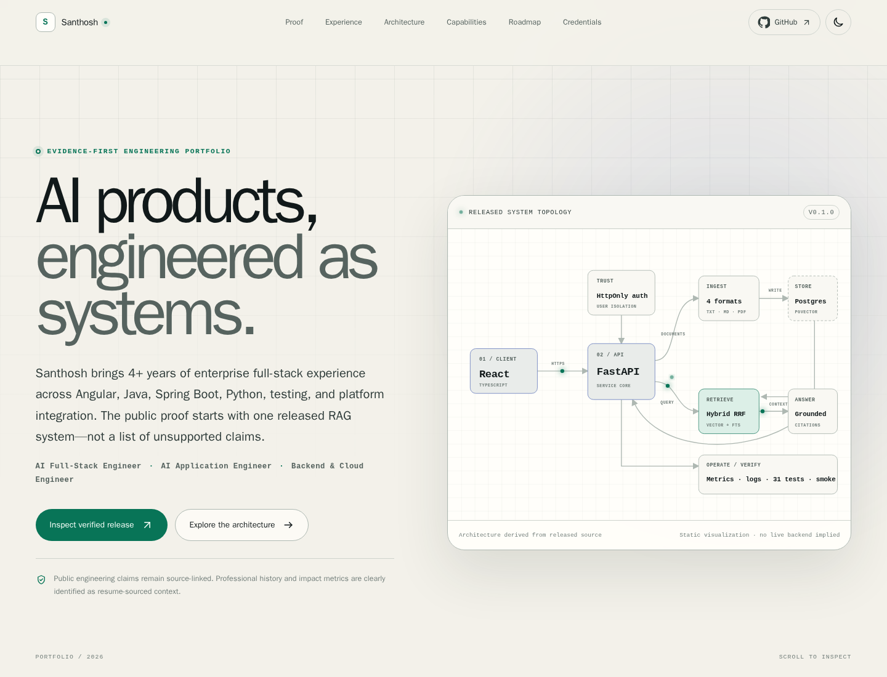
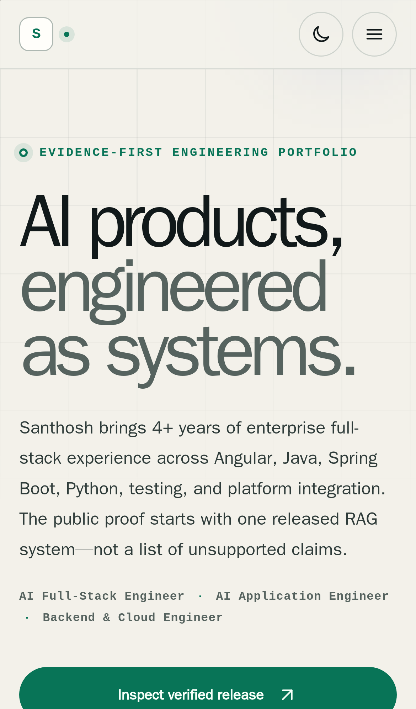

# Santhosh — Engineering Portfolio

Production-oriented source for [santhoshreddy1999.github.io](https://santhoshreddy1999.github.io/), built as an evidence-first portfolio for AI application, full-stack, backend, and cloud engineering.

The site deliberately separates four claim types:

- **Released** — public source and a tagged release exist.
- **Verified** — a public workflow or measurable artifact supports the claim.
- **Existing knowledge asset** — content exists, but is not represented as runnable project work.
- **Planned** — roadmap intent only; no repository or implementation is implied.

## Preview





## Verified portfolio scope

The flagship evidence is [`enterprise-rag-assistant`](https://github.com/Santhoshreddy1999/enterprise-rag-assistant), released as [`v0.1.0`](https://github.com/Santhoshreddy1999/enterprise-rag-assistant/releases/tag/v0.1.0).

The portfolio links to its public evidence instead of querying GitHub at runtime:

- 22 backend tests and 9 frontend tests, 31 total
- 87% measured backend coverage
- backend and frontend image builds
- PostgreSQL end-to-end smoke test
- secret scan
- protected `main` with six required checks
- passing [release workflow](https://github.com/Santhoshreddy1999/enterprise-rag-assistant/actions/runs/42590199024)

The 15-project program is represented as exactly one released MVP and fourteen clearly marked plans.

Professional context is synthesized from the supplied current resume set:

- Full Stack Software Engineer at Tektronix from September 2022 to present
- Testing Engineer Intern at DXC Technology during 2021–2022
- B.Tech in Computer Science Engineering, Lovely Professional University,
  2018–2022
- public email and LinkedIn contact
- verified Anthropic **Introduction to Model Context Protocol** certificate

The public site intentionally omits the supplied phone number and residential
address. Resume-reported impact metrics are visually labeled and are not mixed
with repository-verified quality evidence.

## Architecture

```text
index.html
  └─ React 19 application
      ├─ reusable evidence, capability, architecture, and roadmap data
      ├─ accessible navigation and theme preference
      ├─ custom SVG system topology
      ├─ interactive architecture explorer
      └─ responsive, theme-aware custom CSS

public/
  ├─ crawl and discovery metadata
  ├─ profile and credential media
  ├─ privacy-sanitized print resume
  ├─ manifest and vector identity assets
  └─ standalone GitHub Pages 404 fallback

GitHub Actions
  ├─ PR: install → lint → typecheck → test → build
  └─ main: same checks → Pages artifact → deploy
```

There is no client-side router and no runtime API dependency. Every route-independent asset is emitted by Vite and the custom `404.html` provides a safe recovery path on GitHub Pages.

## Technology

- React 19
- strict TypeScript
- Vite
- Vitest
- Testing Library
- ESLint flat configuration
- original CSS and SVG; no UI framework or remote font dependency

## Local setup

Requirements:

- Node.js 24
- npm 11 or newer

```bash
npm install
npm run dev
```

Open the URL printed by Vite.

If host npm cannot access the registry, use the same containerized fallback used for verification:

```powershell
docker run --rm -it -p 5173:5173 -v "${PWD}:/app" -w /app node:24-alpine npm install
docker run --rm -it -p 5173:5173 -v "${PWD}:/app" -w /app node:24-alpine npm run dev -- --host 0.0.0.0
```

## Quality commands

```bash
npm run lint
npm run typecheck
npm run test
npm run build
npm run check
```

The tests enforce both application behavior and content integrity:

- exactly one released and fourteen planned projects
- no planned project receives a repository URL
- roadmap sequence completeness
- quantitative evidence links
- core render and navigation behavior
- theme switching and persistence
- interactive architecture behavior
- safe external-link attributes

## Content model

Portfolio claims live in `src/data/portfolio.ts`. Keep content there when possible instead of duplicating facts across components.

When adding a project:

1. Choose `released` only when public implementation evidence exists.
2. Use `planned` for intent and keep `repositoryUrl` set to `null`.
3. Link quantitative claims to a public artifact.
4. Update the invariant tests if the verified program state genuinely changes.

## Deployment

`.github/workflows/pages.yml` builds on pull requests and deploys only from `main`.

The workflow:

1. uses Node 24 and `npm ci`;
2. runs lint, strict typecheck, tests, and the production build;
3. uploads a Pages artifact only for `main`;
4. deploys through GitHub Pages with scoped permissions and deployment concurrency.

Repository Pages settings must use **GitHub Actions** as the source. This project does not publish itself from a local command.

## Security notes

- The site is static and has no authentication or token storage.
- It makes no runtime GitHub API calls.
- Only the theme preference is stored in `localStorage`.
- External links use a new tab with `noreferrer`.
- Content is authored at build time; no remote HTML is rendered.
- No secret, API key, analytics identifier, or cloud endpoint is required.
- Dependency and source changes must pass the documented checks before deployment.

See [SECURITY.md](SECURITY.md) for responsible reporting.

## Accessibility

- semantic landmarks and headings
- skip link and sticky navigation
- keyboard-operable controls
- visible focus indicators
- labeled theme and mobile-menu controls
- reduced-motion support
- responsive layouts from mobile through wide desktop
- contrast-aware dark and light themes

## Performance design

No synthetic performance score is claimed. The implementation reduces avoidable runtime cost through:

- static content and build-time data
- no runtime GitHub requests
- no heavyweight component library
- no third-party font or analytics request
- one React entry point with minified production assets
- responsive local profile and certificate media with explicit dimensions
- CSS motion that respects reduced-motion preferences

Source maps are emitted for inspectability. They can be disabled later if repository policy requires smaller deployment artifacts.

## Project governance

- [Content integrity and resume reconciliation](docs/content-integrity.md)
- [Contributing guide](CONTRIBUTING.md)
- [Security policy](SECURITY.md)
- [Changelog](CHANGELOG.md)
- [MIT license](LICENSE)

## License

MIT © 2026 Santhoshreddy1999
